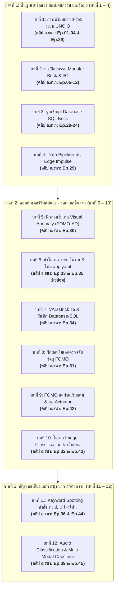

# คู่มือผังการรับชมคลิปการสอนของอาจารย์ธนา ตามหลักสูตร KT-Edu Platform
**แพลตฟอร์มการเรียนรู้:** [KT-Edu Digital Learning Platform](http://localhost:3000/index.html#section-lessons)  
**หลักสูตรความร่วมมือ:** depa & KT-Edu  
**วิทยากรผู้บรรยาย:** นายธนา อุดมศรีไพบูลย์ (อ.ธนา)  
**ลิงก์รวมเพลย์ลิสต์ YouTube ทางการ:** [Arduino UNO Q Playlist (PL_P41WM_1HxGmyUuNPQQsDa-ItaDu5VyU)](https://youtube.com/playlist?list=PL_P41WM_1HxGmyUuNPQQsDa-ItaDu5VyU)  
**ลิงก์ดาวน์โหลดสไลด์ประกอบการสอน (Box Cloud):** [คลิกเพื่อเปิดโฟลเดอร์สไลด์](https://app.box.com/s/3gl7jnelf5uj39csjocopzsphuc8i0pu)

---

## 📌 โครงสร้างความสัมพันธ์ระหว่างบทเรียนบนเว็บแพลตฟอร์ม กับคลิปของอาจารย์ธนา

ชื่อบทเรียนในเอกสารฉบับนี้อ้างอิงตรงตามหน้าหลักสูตร **[KT-Edu Digital Learning Platform (section-lessons)](http://localhost:3000/index.html#section-lessons)** โดยเชื่อมโยงกับชุดคลิปของอาจารย์ธนาบน YouTube ดังนี้:

---

## 📋 ตารางสรุป: ชื่อบทเรียนบน KT-Edu Platform เทียบกับคลิปของอาจารย์ธนา (Ep.)

| บทที่ | ชื่อบทเรียนบนเว็บแพลตฟอร์ม (KT-Edu Platform) | ชื่อบทเรียนภาษาอังกฤษ | คลิปอาจารย์ธนาที่ต้องรับชม | ลิงก์ตรง YouTube |
| :---: | :--- | :--- | :---: | :---: |
| **1** | **การเตรียมความพร้อมระบบและบอร์ดพัฒนา Arduino UNO Q** | System Environment Setup & Arduino UNO Q Preparation | **Ep.01 – Ep.04** และ **Ep.29** | [Ep.01 ติดตั้ง App Lab](https://www.youtube.com/watch?v=oVg57hOrU4s) [Ep.02 ติดตั้ง Debian Linux](https://www.youtube.com/watch?v=IUrO0bfUvc0) [Ep.03 Initial Setup บอร์ด](https://www.youtube.com/watch?v=cRO5jjGtE_k) [Ep.04 สร้าง App บน App Lab](https://www.youtube.com/watch?v=nO3FicIusQs) [Ep.29 เริ่มต้น Edge Impulse](https://www.youtube.com/watch?v=-X8y_aeMAFY&t=52s) |
| **2** | **สถาปัตยกรรมซอฟต์แวร์แบบมอดูล (Modular Brick) และการควบคุมฮาร์ดแวร์พื้นฐาน** | Modular 'Brick' Architecture & Hardware I/O Control | **Ep.05 – Ep.12** | [ดูเพลย์ลิสต์](https://youtube.com/playlist?list=PL_P41WM_1HxGmyUuNPQQsDa-ItaDu5VyU) |
| **3** | **การจัดการระบบฐานข้อมูลบนอุปกรณ์ด้วย Database-SQL Brick** | Local Database Management using 'Database-SQL Brick' | **Ep.20 – Ep.24** | [ดูเพลย์ลิสต์](https://youtube.com/playlist?list=PL_P41WM_1HxGmyUuNPQQsDa-ItaDu5VyU) |
| **4** | **การจัดเตรียมชุดข้อมูลและการออกแบบขั้นตอนการประมวลผล (Data Pipeline) บน Edge Impulse** | Data Acquisition & Data Pipeline Design on Edge Impulse | **Ep.29** | [ดูคลิป Ep.29](https://www.youtube.com/watch?v=-X8y_aeMAFY&t=52s) |
| **5** | **การฝึกสอนโมเดลตรวจจับความผิดปกติจากภาพ (Visual Anomaly Detection)** | Training Visual Anomaly Detection (FOMO-AD) Models | **Ep.30** | [ดูคลิป Ep.30](https://www.youtube.com/watch?v=1yEMEJnsrUY) |
| **6** | **การนำโมเดล .eim ไปใช้งานและการกำหนดค่าไฟล์ app.yaml บนบอร์ดพัฒนา Arduino UNO Q** | Deploying Native .eim Models & Configuring app.yaml | **Ep.33** (หลัก) **Ep.35** (ถ่ายซ่อม) | [ดูคลิป Ep.33](https://www.youtube.com/watch?v=3mAwLsQjv6U&list=PL_P41WM_1HxGmyUuNPQQsDa-ItaDu5VyU&index=31) [ดูคลิป Ep.35](https://www.youtube.com/watch?v=0g2F-s-7O2U&list=PL_P41WM_1HxGmyUuNPQQsDa-ItaDu5VyU&index=34) |
| **7** | **การประมวลผลโมเดลตรวจจับความผิดปกติจากภาพ และการบันทึกข้อมูลลง Database-SQL Brick** | Running Visual Anomaly Detection & Logging Events to Database-SQL Brick | **Ep.34** | [ดูคลิป Ep.34](https://www.youtube.com/watch?v=5Xiz_W53yU0&list=PL_P41WM_1HxGmyUuNPQQsDa-ItaDu5VyU&index=33) |
| **8** | **การฝึกสอนโมเดลตรวจจับวัตถุด้วยสถาปัตยกรรม FOMO (Object Detection)** | Training Ultra-Fast Object Detection Models using FOMO | **Ep.31** | [ดูคลิป Ep.31](https://www.youtube.com/watch?v=glQx9GTLEUI&list=PL_P41WM_1HxGmyUuNPQQsDa-ItaDu5VyU&index=30) |
| **9** | **การนำโมเดล FOMO ไปใช้งานและการควบคุมอุปกรณ์ขับเคลื่อน (Actuator)** | Deploying FOMO Object Detection & Actuator Integration | **Ep.42** | [ดูคลิป Ep.42](https://www.youtube.com/watch?v=6DlVYQzgrEw&list=PL_P41WM_1HxGmyUuNPQQsDa-ItaDu5VyU&index=41) |
| **10** | **การพัฒนาและประมวลผลโมเดลจำแนกประเภทภาพ (Image Classification)** | Training & Deploying Image Classification Models with Webcams | **Ep.32** และ **Ep.43** | [ดูคลิป Ep.32](https://www.youtube.com/watch?v=3EmkC1QBZK0&list=PL_P41WM_1HxGmyUuNPQQsDa-ItaDu5VyU&index=32) [ดูคลิป Ep.43](https://www.youtube.com/watch?v=bLw9BH5RrFo&list=PL_P41WM_1HxGmyUuNPQQsDa-ItaDu5VyU&index=42) |
| **11** | **การประมวลผลสัญญาณเสียงและการฝึกสอนโมเดลรู้จำคำสั่งเสียง (Keyword Spotting: KWS)** | Audio Processing & Thai Keyword Spotting (KWS) Deployment | **Ep.36** และ **Ep.44** | [ดูคลิป Ep.36](https://www.youtube.com/watch?v=Lt5RQeWXZBA&list=PL_P41WM_1HxGmyUuNPQQsDa-ItaDu5VyU&index=35) [ดูคลิป Ep.44](https://www.youtube.com/watch?v=CRpBHlDRh60&list=PL_P41WM_1HxGmyUuNPQQsDa-ItaDu5VyU&index=43) |
| **12** | **การจำแนกเสียงเฉพาะทางและการบูรณาการระบบ Edge AI เชิงวิศวกรรม** | Audio Classification & Full-Scale Edge AI Engineering Integration | **Ep.39** และ **Ep.45** | [ดูคลิป Ep.39](https://www.youtube.com/watch?v=9R-vpS6F4jA&list=PL_P41WM_1HxGmyUuNPQQsDa-ItaDu5VyU&index=38) [ดูคลิป Ep.45](https://www.youtube.com/watch?v=OSzculUyvaY&list=PL_P41WM_1HxGmyUuNPQQsDa-ItaDu5VyU&index=44) |

---

## 📖 รายละเอียดสาระสำคัญและสิ่งที่ต้องศึกษาในแต่ละบทเรียน

### 📘 บทที่ 1: การเตรียมความพร้อมระบบและบอร์ดพัฒนา Arduino UNO Q
* **ชื่อภาษาอังกฤษ:** System Environment Setup & Arduino UNO Q Preparation
* **คลิปอาจารย์ธนาที่เกี่ยวข้องครบทั้ง 5 ตอน:**
  - **Ep.01:** [Arduino UNO Q (Ep.1) Installing Arduino App Lab on your computer](https://www.youtube.com/watch?v=oVg57hOrU4s) (การติดตั้งโปรแกรมสภาพแวดล้อม Arduino App Lab)
  - **Ep.02:** [Arduino UNO Q (Ep.2) Installing Debian Linux operating system on Arduino UNO Q](https://www.youtube.com/watch?v=IUrO0bfUvc0) (สถาปัตยกรรมและการตรวจสอบระบบปฏิบัติการ Debian Linux AArch64)
  - **Ep.03:** [Arduino UNO Q (Ep.3) Initial setup for Arduino UNO Q board to use Arduino App Lab](https://www.youtube.com/watch?v=cRO5jjGtE_k) (การตั้งค่าเริ่มต้นบอร์ดและการเชื่อมต่อโหมดเครือข่าย Wi-Fi/LAN)
  - **Ep.04:** [Arduino UNO Q (Ep.4) Get started with Arduino App Lab to create an app to use with the Arduino UNO Q](https://www.youtube.com/watch?v=nO3FicIusQs) (การเริ่มต้นสร้างแอปพลิเคชันและการควบคุมบอร์ด)
* **เอกสารประกอบการบรรยาย (PDF) จากคลิปการสอน (Box Cloud):** [Arduino App Lab | Powered by Box](https://app.box.com/s/vvstsd7x58cf4eoj9s03ftglpgd3d434)
  - `Introduction to App Lab.pdf` (การเริ่มต้นใช้งานและทำความเข้าใจเครื่องมือ App Lab)
  - `ลงลีนุกส์ใหม่.pdf` (คู่มือและขั้นตอนการ Flash ระบบปฏิบัติการ Debian Linux AArch64 ลงบอร์ด)
  - `การโปรแกรมบอร์ด Arduino UNO Q ด้วยโหมดเน็ตเวิร์ค.pdf` (การโปรแกรมผ่านโหมดเครือข่าย Wi-Fi/LAN)
  - `ABX00162-ABX00173-datasheet.pdf` (เอกสารข้อมูลทางเทคนิคสถาปัตยกรรมฮาร์ดแวร์บอร์ด Arduino UNO Q)
  - `App คืออะไร.pdf` (โครงสร้างและองค์ประกอบของแอปพลิเคชันบน Arduino App Lab)
  - `Brick คืออะไร.pdf` (แนวคิดสถาปัตยกรรม Modular Brick)
  - `โมเดลปัญญาประดิษฐ์.pdf` (ภาพรวมโมเดล AI และการประมวลผลบน Edge Device)
  - `ตัวอย่างที่มีมาให้พร้อมใช้งาน.pdf` (ตัวอย่างโค้ดและ Brick สำเร็จรูปในระบบ)
* **สาระสำคัญ:** สถาปัตยกรรมหน่วยประมวลผล Qualcomm Dragonwing QRB2210 ร่วมกับ Linux AArch64, โหมดเครือข่าย Wi-Fi Station & Hotspot, และภาพรวมกระบวนการพัฒนา Edge AI

---

### 📘 บทที่ 2: สถาปัตยกรรมซอฟต์แวร์แบบมอดูล (Modular Brick) และการควบคุมฮาร์ดแวร์พื้นฐาน
* **ชื่อภาษาอังกฤษ:** Modular 'Brick' Architecture & Hardware I/O Control
* **คลิปอาจารย์ธนาที่ต้องดู:**
  - **Ep.05 – Ep.12:** การใช้งานโมดูล Modular Brick, การควบคุมขา Digital I/O, และการแสดงผล Matrix LED
* **สาระสำคัญ:** โครงสร้างโมดูลาร์ซอฟต์แวร์แบบ Brick, การสื่อสารระหว่างโพรเซสเซอร์ (IPC), และการแสดงผลสถานะระบบผ่านหน้าจอ LED Matrix 8x13 บนตัวบอร์ด

---

### 📘 บทที่ 3: การจัดการระบบฐานข้อมูลบนอุปกรณ์ด้วย Database-SQL Brick
* **ชื่อภาษาอังกฤษ:** Local Database Management using 'Database-SQL Brick'
* **คลิปอาจารย์ธนาที่ต้องดู:**
  - **Ep.20 – Ep.24:** การใช้งานระบบฐานข้อมูล SQLite และโมดูล Database Brick บน Arduino App Lab
* **สาระสำคัญ:** การออกแบบตารางฐานข้อมูลสำหรับจัดเก็บ Event Log ของ AI, การเขียนคำสั่ง Python เชื่อมต่อฐานข้อมูล SQLite, และการออกรายงานสถิติประจำวัน (Daily Summary Analytics)

---

### 📘 บทที่ 4: การจัดเตรียมชุดข้อมูลและการออกแบบขั้นตอนการประมวลผล (Data Pipeline) บน Edge Impulse
* **ชื่อภาษาอังกฤษ:** Data Acquisition & Data Pipeline Design on Edge Impulse
* **คลิปอาจารย์ธนาที่ต้องดู:**
  - **Ep.29:** [Arduino UNO Q (Ep.29) เริ่มต้นใช้งาน Edge Impulse เพื่อเทรนโมเดล AI](https://www.youtube.com/watch?v=-X8y_aeMAFY&t=52s)
* **สาระสำคัญ:** สถาปัตยกรรม Data Pipeline บน Edge Impulse Studio, การแบ่งสัดส่วนข้อมูล Train ต่อ Test ในอัตราส่วน 80:20, การปรับขนาดภาพและลดสัญญาณรบกวน, และการสกัดคุณลักษณะ (Feature Extraction)

---

### 📘 บทที่ 5: การฝึกสอนโมเดลตรวจจับความผิดปกติจากภาพ (Visual Anomaly Detection)
* **ชื่อภาษาอังกฤษ:** Training Visual Anomaly Detection (FOMO-AD) Models
* **คลิปอาจารย์ธนาที่ต้องดู:**
  - **Ep.30:** [Arduino UNO Q (Ep.30) การเทรนโมเดล AI ให้ใช้กับงาน Visual Anomaly Detection (Brick)](https://www.youtube.com/watch?v=1yEMEJnsrUY)
* **สาระสำคัญ:** หลักการ One-Class Learning โดยใช้เฉพาะชิ้นงานปกติสมบูรณ์ในการเทรน, การเลือกใช้บล็อกการเรียนรู้ FOMO-AD, การตรวจสอบ 3D Feature Explorer, และการตัดเกณฑ์ค่า Anomaly Score (ปกติ 0-5, ผิดปกติ >20)

---

### 📘 บทที่ 6: การนำโมเดล .eim ไปใช้งานและการกำหนดค่าไฟล์ app.yaml บนบอร์ดพัฒนา Arduino UNO Q
* **ชื่อภาษาอังกฤษ:** Deploying Native .eim Models & Configuring app.yaml
* **คลิปอาจารย์ธนาที่ต้องดู:**
  - **Ep.33:** [Arduino UNO Q (Ep.33) กระบวนการ Deploy ไฟล์โมเดล (.eim) สู่บอร์ด Arduino UNO Q](https://www.youtube.com/watch?v=3mAwLsQjv6U&list=PL_P41WM_1HxGmyUuNPQQsDa-ItaDu5VyU&index=31)
  - **Ep.35 (ถ่ายซ่อม):** [ถ่ายซ่อมการแก้ไขไฟล์ app.yaml](https://www.youtube.com/watch?v=0g2F-s-7O2U&list=PL_P41WM_1HxGmyUuNPQQsDa-ItaDu5VyU&index=34)
* **สาระสำคัญ:** การแปลงโมเดลเป็นไบนารี AArch64 (.eim), การโอนย้ายเข้าไดเรกทอรี `/home/arduino/.arduino-bricks/ei-models/`, สิทธิ์การประมวลผล `chmod +x`, และการระบุชื่อโมเดลใน `app.yaml` ภายใต้ตัวแปร `variables: { ... }` อย่างถูกต้อง

---

### 📘 บทที่ 7: การประมวลผลโมเดลตรวจจับความผิดปกติจากภาพ และการบันทึกข้อมูลลง Database-SQL Brick
* **ชื่อภาษาอังกฤษ:** Running Visual Anomaly Detection & Logging Events to Database-SQL Brick
* **คลิปอาจารย์ธนาที่ต้องดู:**
  - **Ep.34:** [Arduino UNO Q (Ep.34) รู้จักกับ “Visual Anomaly Detection Brick” บน Arduino App Lab](https://www.youtube.com/watch?v=5Xiz_W53yU0&list=PL_P41WM_1HxGmyUuNPQQsDa-ItaDu5VyU&index=33)
* **สาระสำคัญ:** การเรียกใช้คลาส `VisualAnomalyDetection` บน Arduino App Lab, การเขียนสคริปต์ไพทอนวนลูปอ่านภาพจากโฟลเดอร์ `PicsTesting/`, การประเมินผล `anomaly_max_score`, และการบันทึก Log ลงฐานข้อมูล SQLite

---

### 📘 บทที่ 8: การฝึกสอนโมเดลตรวจจับวัตถุด้วยสถาปัตยกรรม FOMO (Object Detection)
* **ชื่อภาษาอังกฤษ:** Training Ultra-Fast Object Detection Models using FOMO
* **คลิปอาจารย์ธนาที่ต้องดู:**
  - **Ep.31:** [Arduino UNO Q (Ep.31) การเทรนโมเดล AI ให้ใช้กับงาน Object Detection (Brick)](https://www.youtube.com/watch?v=glQx9GTLEUI&list=PL_P41WM_1HxGmyUuNPQQsDa-ItaDu5VyU&index=30)
* **สาระสำคัญ:** โครงสร้างโมเดล Faster Objects, More Objects (FOMO) บนสถาปัตยกรรม MobileNetV2 0.35, การกำหนดกรอบ Bounding Box ใน Labeling Queue, การวิเคราะห์ตาราง Confusion Matrix, Precision, Recall และ F1-Score

---

### 📘 บทที่ 9: การนำโมเดล FOMO ไปใช้งานและการควบคุมอุปกรณ์ขับเคลื่อน (Actuator)
* **ชื่อภาษาอังกฤษ:** Deploying FOMO Object Detection & Actuator Integration
* **คลิปอาจารย์ธนาที่ต้องดู:**
  - **Ep.42:** [Arduino UNO Q (Ep.42) การเทรนโมเดล AI ให้ใช้กับงาน Object Detection (Brick) ผ่านกล้องเว็ปแคม](https://www.youtube.com/watch?v=6DlVYQzgrEw&list=PL_P41WM_1HxGmyUuNPQQsDa-ItaDu5VyU&index=41)
* **สาระสำคัญ:** การต่อกล้องเว็บแคม USB เข้ากับ UNO Q, การทำงานร่วมกันระหว่างโมดูล `video_object_detection` และ `web_ui` บนพอร์ต 7000, การสกัดพิกัดจุดกึ่งกลาง (Centroid Coordinates) เพื่อส่งคำสั่งไปควบคุมเซอร์โวมอเตอร์หรือแขนกลคัดแยก

---

### 📘 บทที่ 10: การพัฒนาและประมวลผลโมเดลจำแนกประเภทภาพ (Image Classification)
* **ชื่อภาษาอังกฤษ:** Training & Deploying Image Classification Models with Webcams
* **คลิปอาจารย์ธนาที่ต้องดู:**
  - **Ep.32:** [Arduino UNO Q (Ep.32) การเทรนโมเดล AI ให้ใช้กับงาน Image Classification (Brick)](https://www.youtube.com/watch?v=3EmkC1QBZK0&list=PL_P41WM_1HxGmyUuNPQQsDa-ItaDu5VyU&index=32)
  - **Ep.43:** [Arduino UNO Q (Ep.43) การเทรนโมเดล AI ให้ใช้กับงาน Image Classification (Brick) ผ่านกล้องเว็ปแคม](https://www.youtube.com/watch?v=bLw9BH5RrFo&list=PL_P41WM_1HxGmyUuNPQQsDa-ItaDu5VyU&index=42)
* **สาระสำคัญ:** การเรียนรู้แบบถ่ายโอน (Transfer Learning), การเพิ่มคลาสพื้นหลังว่างเปล่า (`background`) เพื่อแก้ปัญหา Softmax ทำนายผิดพลาดเมื่อไม่มีวัตถุ, การรันโมเดลผ่านกล้องเว็บแคมแบบสด, และการวัดค่า Inference Latency

---

### 📘 บทที่ 11: การประมวลผลสัญญาณเสียงและการฝึกสอนโมเดลรู้จำคำสั่งเสียง (Keyword Spotting: KWS)
* **ชื่อภาษาอังกฤษ:** Audio Processing & Thai Keyword Spotting (KWS) Deployment
* **คลิปอาจารย์ธนาที่ต้องดู:**
  - **Ep.36:** [Arduino UNO Q (Ep.36) การเทรนโมเดล AI ให้ใช้กับงาน Keyword Spotting (Brick)](https://www.youtube.com/watch?v=Lt5RQeWXZBA&list=PL_P41WM_1HxGmyUuNPQQsDa-ItaDu5VyU&index=35)
  - **Ep.44:** [Arduino UNO Q (Ep.44) การเทรนโมเดล AI ให้ใช้กับงาน Keyword Spotting (Brick) ผ่านไมโครโฟน (คำสั่งไทย)](https://www.youtube.com/watch?v=CRpBHlDRh60&list=PL_P41WM_1HxGmyUuNPQQsDa-ItaDu5VyU&index=43)
* **สาระสำคัญ:** การแปลงคลื่นเสียงเป็นสเปกโทรแกรม MFCC, การบันทึกและตัดแบ่งเสียงคำสั่งภาษาไทย ('เปิด', 'ปิด', 'แดง', 'เขียว') ด้วย Split sample, การจัดการคำพ้องเสียงในคลาส `unknown`, และการสั่งเปิด-ปิดรีเลย์ด้วยไมโครโฟน

---

### 📘 บทที่ 12: การจำแนกเสียงเฉพาะทางและการบูรณาการระบบ Edge AI เชิงวิศวกรรม
* **ชื่อภาษาอังกฤษ:** Audio Classification & Full-Scale Edge AI Engineering Integration
* **คลิปอาจารย์ธนาที่ต้องดู:**
  - **Ep.39:** [Arduino UNO Q (Ep.39) การเทรนโมเดล AI ให้ใช้กับงาน Audio Classification (Brick)](https://www.youtube.com/watch?v=9R-vpS6F4jA&list=PL_P41WM_1HxGmyUuNPQQsDa-ItaDu5VyU&index=38)
  - **Ep.45:** [Arduino UNO Q (Ep.45) การเทรนโมเดล AI ให้ใช้กับงาน Audio Classification (Brick) ผ่านไมโครโฟน](https://www.youtube.com/watch?v=OSzculUyvaY&list=PL_P41WM_1HxGmyUuNPQQsDa-ItaDu5VyU&index=44)
* **สาระสำคัญ:** การจำแนกเสียงเหตุการณ์ (Acoustic Events) เช่น เสียงสุนัขเห่า เสียงกระจกแตก หรือเสียงเครื่องจักรผิดปกติ, การหลอมรวมข้อมูลภาพและเสียง (Multi-Modal AI), การบันทึกลง Database-SQL เพื่อระบบบำรุงรักษาเชิงคาดการณ์ (Predictive Maintenance), และข้อตระหนักด้าน PDPA
