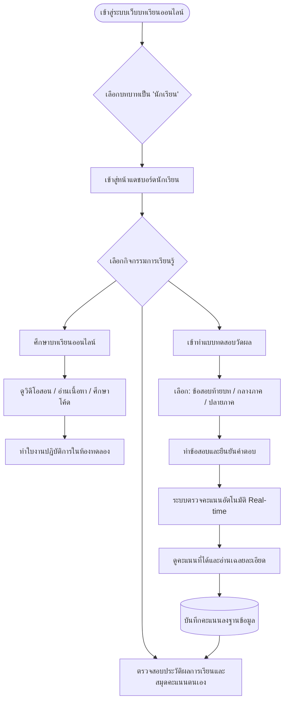
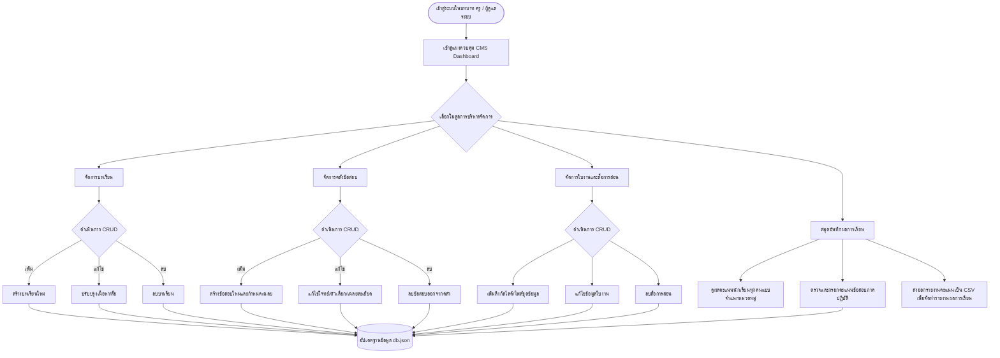

# โครงสร้างและสถาปัตยกรรมเว็บบทเรียนออนไลน์
## รายวิชาเพิ่มเติม: ปัญญาประดิษฐ์บนระบบสมองกลฝังตัว (Embedded Artificial Intelligence)
**รหัสวิชา ว302XX | กลุ่มสาระการเรียนรู้วิทยาศาสตร์และเทคโนโลยี**

---

### 1. บทนำและวัตถุประสงค์ของระบบ (System Overview & Objectives)

ระบบเว็บบทเรียนออนไลน์รายวิชา **"ปัญญาประดิษฐ์บนระบบสมองกลฝังตัว" (Embedded Artificial Intelligence)** พัฒนาขึ้นเพื่อเป็นแพลตฟอร์มการจัดการเรียนรู้ดิจิทัล (Digital Learning Platform & CMS) ที่สนับสนุนการจัดการเรียนรู้ฐานสมรรถนะและการเรียนรู้เชิงรุก (Active Learning) มุ่งเน้นการบูรณาการองค์ความรู้ด้านระบบสมองกลฝังตัว (Arduino UNO Q) ร่วมกับแพลตฟอร์ม Edge Impulse Studio โดยระบบได้รับการออกแบบตามมาตรฐานความปลอดภัยและการควบคุมสิทธิ์การเข้าถึงตามบทบาท (Role-Based Access Control: RBAC) แบ่งผู้ใช้งานออกเป็น 2 บทบาทหลัก ได้แก่ **นักเรียน (Student)** และ **ครูผู้สอน / ผู้ดูแลระบบ (Teacher / Administrator)**

---

### 2. ผังโครงสร้างสารสนเทศและแผนผังเว็บไซต์ (Information Architecture & Sitemap)

```
[ แพลตฟอร์มบทเรียนออนไลน์ Edge AI ]
 │
 ├── [การพิสูจน์ตัวตน & สลับบทบาท (Authentication & Role Switcher)]
 │    ├── สิทธิ์: นักเรียน (Student Mode)
 │    └── สิทธิ์: ครูผู้สอน / ผู้ดูแลระบบ (Teacher & Admin Mode)
 │
 ├── [ส่วนการใช้งานของนักเรียน (Student Portal)]
 │    ├── แดชบอร์ดผู้เรียน (Learning Dashboard & Progress)
 │    ├── บทเรียนออนไลน์ (Lesson Modules)
 │    │    ├── สาระสำคัญและผลการเรียนรู้
 │    │    ├── เอกสารประกอบและสไลด์บรรยาย (PDF Viewer)
 │    │    ├── วิดีโอบรรยายทางวิศวกรรม (Video Lecture Player)
 │    │    └── คลังโค้ดตัวอย่างและการอธิบายคำสั่ง (Code Sandbox & Copy)
 │    ├── ใบงานปฏิบัติการในห้องทดลอง (Lab Worksheets 1–12)
 │    │    └── ขั้นตอนการทดลองและการบันทึกผล
 │    ├── ระบบทดสอบวัดผลออนไลน์ (Online Assessment System)
 │    │    ├── แบบทดสอบปรนัยรายบท (แบบทดสอบประจำบท รวม 120 ข้อ)
 │    │    ├── แบบทดสอบวัดผลกลางภาคเรียน (20 ข้อ)
 │    │    ├── แบบทดสอบวัดผลปลายภาคเรียน (20 ข้อ)
 │    │    └── ระบบตรวจคะแนนอัตโนมัติพร้อมเฉลยละเอียดเชิงวิชาการ
 │    └── ทะเบียนผลการเรียนรายบุคคล (Student Scorecard & History)
 │
 └── [ส่วนการบริหารจัดการของครูและผู้ดูแลระบบ (Teacher/Admin CMS)]
      ├── แดชบอร์ดบริหารจัดการ (Administrative Analytics Dashboard)
      │    ├── สถิติจำนวนผู้เรียนและอัตราการสำเร็จการศึกษา
      │    └── แผนภูมิกระจายตัวของผลคะแนนสอบ (Score Distribution)
      ├── จัดการบทเรียน (Lesson Management - CRUD)
      │    ├── เพิ่มบทเรียนใหม่ (Create)
      │    ├── แก้ไขเนื้อหา วิดีโอ สไลด์ (Update)
      │    └── ลบบทเรียน (Delete)
      ├── จัดการคลังข้อสอบ (Quiz & Item Bank Management - CRUD)
      │    ├── เพิ่มข้อสอบปรนัยและอัตนัย (Create)
      │    ├── ปรับปรุงคำถาม ตัวเลือก เกณฑ์เฉลย (Update)
      │    └── ลบข้อสอบออกจากคลัง (Delete)
      ├── จัดการใบงานและสื่อการสอน (Worksheets & Media Management - CRUD)
      │    ├── เพิ่มลิงก์และไฟล์สื่อการสอน/ชุดข้อมูล (Create)
      │    ├── ปรับปรุงคำอธิบายใบงาน (Update)
      │    └── ลบสื่อการสอนที่ไม่เกี่ยวข้อง (Delete)
      └── สมุดบันทึกผลการเรียนและการวัดผล (Gradebook & Evaluation)
           ├── ดูคะแนนสอบรายบุคคลและรายกลุ่ม
           ├── บันทึกคะแนนข้อสอบภาคปฏิบัติ (Rubrics Scoring)
           └── ส่งออกรายงานผลการเรียน (Export Report CSV / PDF)
```

---

### 3. การออกแบบสิทธิ์การเข้าใช้งานตามบทบาท (Role-Based Access Control: RBAC Matrix)

| ฟังก์ชันการทำงานในระบบ | นักเรียน (Student) | ครู / ผู้ดูแลระบบ (Teacher / Admin) | รายละเอียดเชิงวิศวกรรมซอฟต์แวร์ |
| :--- | :---: | :---: | :--- |
| **การเข้าดูบทเรียน (View Lessons)** | เข้าถึงได้ (Read Only) | เข้าถึงได้ (Full Access) | อนุญาตให้เรียกข้อมูลผ่าน `GET /api/lessons` |
| **เพิ่มบทเรียนใหม่ (Create Lesson)** | **ไม่อนุญาต** | **ทำได้ (Create)** | ส่งคำขอผ่าน `POST /api/lessons` (ตรวจสอบ Token สิทธิ์ Admin) |
| **แก้ไขบทเรียน (Update Lesson)** | **ไม่อนุญาต** | **ทำได้ (Update)** | ส่งคำขอผ่าน `PUT /api/lessons/:id` |
| **ลบบทเรียน (Delete Lesson)** | **ไม่อนุญาต** | **ทำได้ (Delete)** | ส่งคำขอผ่าน `DELETE /api/lessons/:id` |
| **การทำแบบทดสอบ (Take Quizzes)** | **ทำได้ (Execute)** | ทำได้ (Test/Preview) | บันทึกคำตอบและคำนวณผลผ่าน `POST /api/exams/submit` |
| **ดูเฉลยละเอียด (View Explanations)** | ดูได้เฉพาะหลังส่งข้อสอบ | ดูได้ตลอดเวลา | ควบคุมการส่งข้อมูล Explanation จากฝั่งเซิร์ฟเวอร์ |
| **จัดการคลังข้อสอบ (Quiz CRUD)** | **ไม่อนุญาต** | **ทำได้ (Full CRUD)** | เรียกผ่าน `POST /api/quizzes`, `PUT /api/quizzes/:id`, `DELETE /api/quizzes/:id` |
| **ดาวน์โหลดโค้ดและสื่อการสอน** | ดาวน์โหลดได้ | จัดการไฟล์ได้ | `GET /api/materials`, `POST /api/materials`, `DELETE /api/materials/:id` |
| **ดูประวัติคะแนนของตนเอง** | ดูได้เฉพาะของตนเอง | ดูได้ทั้งหมด | นักเรียนเรียกดูจากรหัสนักเรียนของตนเอง |
| **ดูสมุดคะแนนรวมชั้นเรียน** | **ไม่อนุญาต** | **ทำได้ (Full Access)** | เข้าถึงผ่าน `GET /api/scores/all` พร้อมฟังก์ชันออกรายงาน |
| **ให้คะแนนข้อสอบภาคปฏิบัติ** | **ไม่อนุญาต** | **ทำได้ (Grade)** | บันทึกคะแนนรูบริกผ่าน `POST /api/practical/grade` |

---

### 4. สถาปัตยกรรมทางเทคนิคของระบบ (Technical Architecture)

```
┌────────────────────────────────────────────────────────────────────────┐
│                        FRONTEND CLIENT TIER                            │
│  - Single Page Application (Responsive HTML5 / CSS3 / JavaScript ES6+) │
│  - Tailwind CSS Framework (CDN) & Font Awesome 6 Icons                 │
│  - Chart.js Dashboard Data Visualizations                             │
│  - Role State Switcher & Interactive Exam Engine                      │
└────────────────────────────────────┬───────────────────────────────────┘
                                     │ HTTP / HTTPS (RESTful JSON API)
┌────────────────────────────────────▼───────────────────────────────────┐
│                         BACKEND SERVER TIER                            │
│  - Runtime: Node.js (v18+)                                             │
│  - Framework: Express.js REST API Server                               │
│  - Security & Middleware: Role-Based Access Control, CORS, Body-Parser │
│  - Controllers: Lessons, Quizzes, Worksheets, Scores, Admin CMS        │
└────────────────────────────────────┬───────────────────────────────────┘
                                     │ File System I/O / JSON Persistence
┌────────────────────────────────────▼───────────────────────────────────┐
│                          DATA STORAGE TIER                             │
│  - Primary Storage: Embedded JSON Database (`data/db.json`)             │
│  - Seed Data: บทเรียน, คลังข้อสอบ, ใบงานปฏิบัติการ, โค้ดตัวอย่าง, ลิงก์สื่อ   │
│  - Real-time File Persistence on Create / Update / Delete              │
└────────────────────────────────────────────────────────────────────────┘
```

#### 4.1 อัตลักษณ์และการออกแบบส่วนติดต่อผู้ใช้ (KT-Edu Theme & Design System)
* **ตราสัญลักษณ์ประจำแพลตฟอร์ม (KT-Edu Official Brand Logo):**
  * โลโก้ตราสัญลักษณ์ทรงกลม (Circular Badge) ของ **KT-Edu**
  * ปรับโทนสัญลักษณ์จากสีเขียวเป็นสีเหลือง **Electric Yellow** (`#fff200`) เข้าคู่กับสีกรมท่าเข้มอย่างลงตัว
  * ติดตั้งในส่วนหัว (Navbar Header), ส่วนท้าย (Footer) และไอคอนแท็บเบราว์เซอร์ (Favicon)
* **สีอัตลักษณ์ระบบ (Color Palette):**
  * `Primary Navy Blue`: `#173b6b` (สีน้ำเงินเข้ม สื่อถึงความมั่นคงและความเป็นเลิศทางเทคโนโลยี)
  * `Accent Yellow`: `#fff200` (สีเหลือง KT-Edu สื่อถึงพลังความคิดสร้างสรรค์ นวัตกรรม และพลังขับเคลื่อนดิจิทัล)
  * `Deep Navy Background`: `#0d2342` (สีพื้นหลังส่วนหัว ส่วนท้าย และแถบเนวิเกชัน)
* **แถบการเข้าถึงเพื่อทุกคน (Accessibility Toolbar):**
  * ปุ่มปรับขนาดอักษร 3 ระดับ (`A-`, `A`, `A+`) พร้อม Toast แจ้งเตือนสถานะ
  * ตัวสลับภาษาและลิงก์สื่อสังคมออนไลน์ทางการ
* **ระบบสไลด์ภาพแบนเนอร์วิชาการ (Hero Image Carousel / Slider):**
  * สไลด์ภาพ 4 ชุด ออกแบบเฉพาะสำหรับรายวิชา Embedded AI พร้อมคุมโทนสีตามอัตลักษณ์ depa:
    1. **สไลด์ที่ 1:** ภาพบอร์ดสมองกลฝังตัว Arduino UNO Q ชิปประมวลผล Qualcomm Snapdragon และโครงข่ายประสาทเทียม AI (`slide1_arduino_edgeai.jpg`)
    2. **สไลด์ที่ 2:** ภาพห้องปฏิบัติการวิศวกรรม AI แพลตฟอร์ม Edge Impulse Studio, Bounding Box วัตถุ และคลื่นเสียง Spectrogram (`slide2_edgeimpulse_vision.jpg`)
    3. **สไลด์ที่ 3:** ภาพการ Deploy โมเดลเนทีฟ `.eim` ผ่านลีนุกซ์ และการบันทึกประวัติการอนุมานลง Database-SQL Brick / SQLite (`slide3_database_deployment.jpg`)
    4. **สไลด์ที่ 4:** ภาพบรรยากาศห้องปฏิบัติการ STEM Robotics & AI Innovation ของผู้เรียนและครู พร้อมแดชบอร์ดประเมินผลการเรียนรู้ (`slide4_assessment_innovation.jpg`)
  * การเลื่อนอัตโนมัติ (Auto-slide ทุก 5 วินาที) พร้อมกลไกหยุดชั่วคราวเมื่อนำเมาส์ชี้ (Pause on hover)
  * ปุ่มลูกศรควบคุมซ้าย-ขวา (Previous/Next Navigation Arrows)
  * จุดบอกตำแหน่งแบบอินเทอร์แอ็กทีฟ (Pagination Dots) ขยายเป็นรูปวงรี (Pill) สีเหลืองเมื่อเปิดใช้งาน
  * รองรับการปัดเลื่อนสัมผัส (Touch Gesture / Swipe) บนอุปกรณ์สมาร์ตโฟนและแท็บเล็ต
* **แถบการ์ดบริการด่วน (Quick Access Service Cards):**
  * ออกแบบเป็นการ์ดยกตัวลอย 6 การ์ดตามอัตลักษณ์หน้าแรก depa เพื่อเข้าถึงบทเรียน ใบงาน คลังข้อสอบ SQL Brick คลังโค้ด และสมุดบันทึกคะแนนได้ในคลิกเดียว

---

### 5. การออกแบบโครงสร้างฐานข้อมูล (Database Schema Design)

ระบบจัดเก็บข้อมูลในโครงสร้างตารางเชิงสัมพันธ์ (Relational Schema / Document Store) ประกอบด้วย 5 กลุ่มข้อมูลหลัก:

#### 5.1 ตารางบทเรียน (`lessons`)
* `id` (String / Integer, Primary Key): รหัสบทเรียน (เช่น `"ch01"`)
* `chapter_number` (Integer): ลำดับที่ของบทเรียน (1–12)
* `title` (String): ชื่อบทเรียนภาษาไทย
* `title_en` (String): ชื่อบทเรียนภาษาอังกฤษ
* `description` (Text): สาระสำคัญและภาพรวมของบทเรียน
* `objectives` (Array of Strings): ผลการเรียนรู้เชิงพฤติกรรม
* `theory_content` (Text / Markdown): เนื้อหาเชิงทฤษฎีและขั้นตอนเชิงลึก
* `video_url` (String): ลิงก์สื่อวิดีโอประกอบการสอน
* `slide_url` (String): ลิงก์เอกสารสไลด์บรรยาย (PDF)
* `code_filename` (String): ชื่อไฟล์ชุดคำสั่งหลัก
* `created_at` / `updated_at` (Timestamp): วันเวลาที่สร้างและปรับปรุงข้อมูล

#### 5.2 ตารางคลังข้อสอบ (`quizzes` / `questions`)
* `id` (String / Integer, Primary Key): รหัสข้อสอบ
* `chapter_id` (String): รหัสบทเรียนที่เชื่อมโยง (หรือ `"midterm"`, `"final"`)
* `question_type` (Enum): ประเภทข้อสอบ (`"multiple_choice"`, `"practical"`)
* `question_text` (Text): คำถามหรือสถานการณ์โจทย์
* `options` (Array of Strings): ตัวเลือก ก, ข, ค, ง (สำหรับข้อสอบปรนัย)
* `correct_index` (Integer): ลำดับตัวเลือกที่ถูกต้อง (0 = ก, 1 = ข, 2 = ค, 3 = ง)
* `explanation` (Text): คำอธิบายเฉลยละเอียดเชิงวิชาการ
* `points` (Integer): คะแนนเต็มของข้อสอบ (ปรนัยข้อละ 1 คะแนน, ปฏิบัติข้อละ 10 คะแนน)
* `rubrics` (Array of Objects): เกณฑ์การประเมินรูบริก (สำหรับข้อสอบภาคปฏิบัติ)

#### 5.3 ตารางใบงานและสื่อการสอน (`materials` / `worksheets`)
* `id` (String, Primary Key): รหัสใบงานหรือสื่อการสอน
* `chapter_id` (String): รหัสบทเรียนที่เกี่ยวข้อง
* `title` (String): ชื่อใบงานหรือสื่อการสอน
* `material_type` (Enum): ประเภท (`"worksheet"`, `"slide"`, `"dataset"`, `"code"`)
* `description` (Text): คำอธิบายและข้อกำหนด
* `file_url` (String): ลิงก์ดาวน์โหลดหรือที่อยู่ไฟล์
* `hardware_requirement` (String): อุปกรณ์ฮาร์ดแวร์ที่ต้องใช้

#### 5.4 ตารางผู้ใช้งานและบทบาท (`users`)
* `id` (String, Primary Key): รหัสประจำตัวผู้ใช้งาน
* `username` (String, Unique): ชื่อผู้ใช้หรือรหัสประจำตัวนักเรียน
* `full_name` (String): ชื่อ-นามสกุล
* `role` (Enum): บทบาท (`"student"` หรือ `"admin"`)
* `class_room` (String): ห้องเรียน (เช่น `"ห้อง 1"`)
* `student_number` (Integer): เลขที่

#### 5.5 ตารางบันทึกผลการทดสอบและคะแนน (`exam_results`)
* `id` (String, Primary Key): รหัสผลการทดสอบ
* `student_id` (String): รหัสประจำตัวนักเรียน
* `student_name` (String): ชื่อ-นามสกุลนักเรียน
* `exam_category` (Enum): ประเภทการสอบ (`"chapter_quiz"`, `"midterm"`, `"final"`, `"practical"`)
* `target_id` (String): บทเรียนหรือรหัสข้อสอบที่เข้าทดสอบ
* `score` (Float): คะแนนที่ได้
* `max_score` (Float): คะแนนเต็ม
* `percentage` (Float): ร้อยละของคะแนน
* `submitted_answers` (Object): คำตอบที่นักเรียนเลือกส่ง
* `created_at` (Timestamp): วันและเวลาที่บันทึกผล

---

### 6. ข้อกำหนดส่วนต่อประสานโปรแกรมประยุกต์ (RESTful API Specifications)

#### 6.1 กลุ่มบริการจัดการบทเรียน (Lessons Endpoints)
* `GET /api/lessons` : ดึงข้อมูลบทเรียนทั้งหมด (นักเรียน และ ครู)
* `GET /api/lessons/:id` : ดึงข้อมูลบทเรียนตามรหัส (นักเรียน และ ครู)
* `POST /api/lessons` : เพิ่มบทเรียนใหม่ (**เฉพาะครู / Admin**)
* `PUT /api/lessons/:id` : แก้ไขข้อมูลบทเรียน (**เฉพาะครู / Admin**)
* `DELETE /api/lessons/:id` : ลบบทเรียนออกจากระบบ (**เฉพาะครู / Admin**)

#### 6.2 กลุ่มบริการจัดการคลังข้อสอบ (Quizzes Endpoints)
* `GET /api/quizzes` : ดึงรายการข้อสอบทั้งหมด (นักเรียนจะถูกซ่อนเฉลย / ครูจะได้รับเฉลยครบถ้วน)
* `GET /api/quizzes/chapter/:chapter_id` : ดึงข้อสอบเฉพาะบทเรียนที่ระบุ
* `POST /api/quizzes` : เพิ่มข้อสอบใหม่เข้าสู่คลัง (**เฉพาะครู / Admin**)
* `PUT /api/quizzes/:id` : ปรับปรุงข้อสอบ ตัวเลือก หรือเฉลย (**เฉพาะครู / Admin**)
* `DELETE /api/quizzes/:id` : ลบข้อสอบออกจากคลัง (**เฉพาะครู / Admin**)
* `POST /api/quizzes/submit` : ส่งคำตอบเพื่อตรวจข้อสอบและบันทึกคะแนน (นักเรียน)

#### 6.3 กลุ่มบริการจัดการใบงานและสื่อการสอน (Materials Endpoints)
* `GET /api/materials` : ดึงรายการสื่อและใบงานทั้งหมด
* `POST /api/materials` : เพิ่มรายการสื่อหรือใบงานใหม่ (**เฉพาะครู / Admin**)
* `PUT /api/materials/:id` : ปรับปรุงข้อมูลสื่อหรือใบงาน (**เฉพาะครู / Admin**)
* `DELETE /api/materials/:id` : ลบรายการสื่อหรือใบงาน (**เฉพาะครู / Admin**)

#### 6.4 กลุ่มบริการจัดการคะแนนและสมุดบันทึกผลการเรียน (Scores & Analytics Endpoints)
* `GET /api/scores` : ดึงข้อมูลคะแนนทั้งหมด (**เฉพาะครู / Admin**)
* `GET /api/scores/student/:student_id` : ดึงประวัติผลคะแนนเฉพาะบุคคล (นักเรียน หรือ ครู)
* `POST /api/scores/practical` : บันทึกคะแนนข้อสอบภาคปฏิบัติรายบุคคล (**เฉพาะครู / Admin**)
* `GET /api/admin/stats` : สรุปสถิติภาพรวมของระบบสำหรับแสดงผลบนแดชบอร์ด (**เฉพาะครู / Admin**)
* `POST /api/admin/reset-data` : รีเซ็ตข้อมูลกลับสู่ค่ามาตรฐานโรงเรียน (**เฉพาะครู / Admin**)

---

### 7. แผนผังการทำงานของระบบ (Workflow & Activity Diagrams)

#### 7.1 ผังการทำงานของนักเรียน (Student Flow)


#### 7.2 ผังการทำงานของครูและผู้ดูแลระบบ (Teacher / Admin Flow)


---

### 8. แนวทางการติดตั้งและรันระบบ (Deployment & Running Instructions)

1. เข้าสู่โฟลเดอร์ระบบเว็บ:
   ```powershell
   cd c:\Users\lenovo\Desktop\EdgeAI\web_learning_platform
   ```
2. ติดตั้งแพ็กเกจ Node.js ที่จำเป็น:
   ```powershell
   npm install
   ```
3. เริ่มต้นการทำงานของเซิร์ฟเวอร์:
   ```powershell
   npm start
   ```
   *(หรือรันคำสั่ง `node server.js`)*
4. เข้าใช้งานผ่านเว็บเบราว์เซอร์:
   * URL หลัก: `http://localhost:3000`
   * สลับบทบาทได้ทันทีจากเมนูแถบด้านบน (Header Bar) ทั้งโหมด **นักเรียน** และโหมด **ครู / ผู้ดูแลระบบ**
